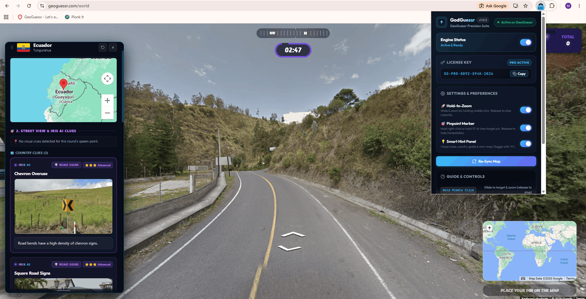
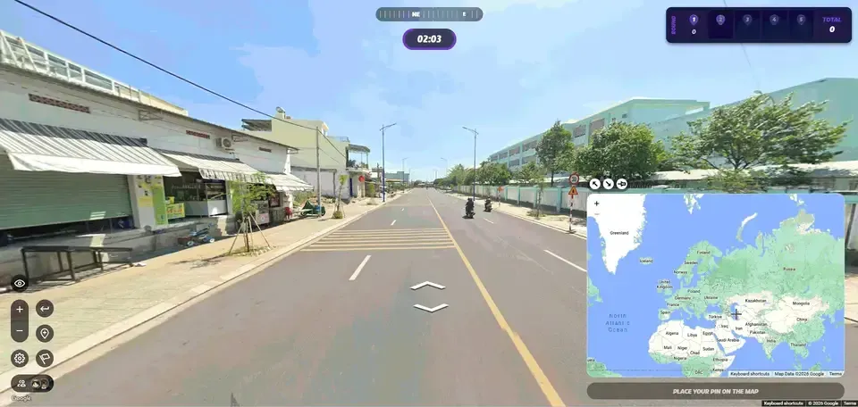
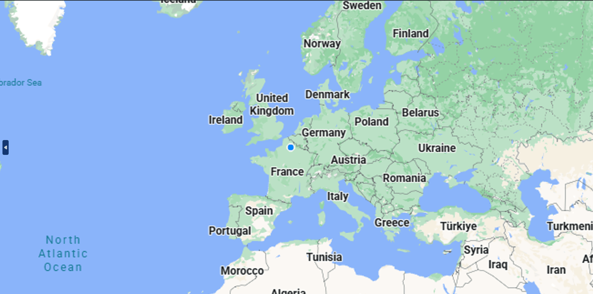
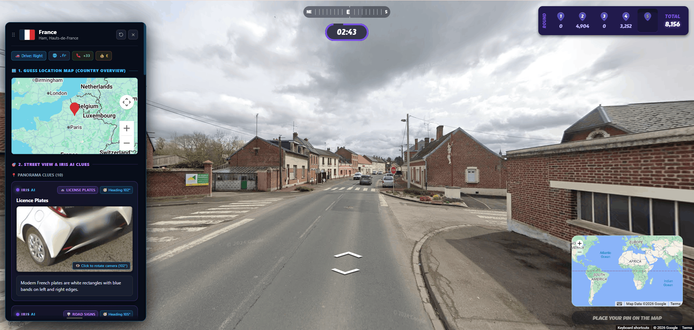

# GodGuessr Pro (Geoguessr Cheat Chrome Extension)

> **GeoGuessr Precision Suite** — Dominate every round of GeoGuessr with pure precision.

GodGuessr Pro is the next-generation Chrome Extension for competitive assistant suite built for flawless rounds. Master your gameplay with seamless **Auto-Zoom** glide, instant **Pinpoint Radar Crosshairs**, and the comprehensive **Smart Hint HUD** without disrupting your natural flow.

---

## 🎬 Gameplay Showcase

> 💡 *Full gameplay demonstration video available at [`Youtube`](https://youtu.be/FRRBied1WqA).*

---

## 🚀 Core Features

### 1. Intelligent Auto-Zoom Engine
Smooth, human-like gliding powered by natural exponential motion curves.

* **Instant Release Freeze**: Hold down the middle mouse button to glide directly toward target coordinates at natural speed. Release your mouse button, scroll, or click anywhere to immediately halt movement at your current position.
* **Smart Out-of-Bounds Detection**: If the target lies beyond the visible screen, the map automatically backs out gracefully until it enters view, then glides in.
* **Natural Motion Curves**: Exponential easing ensures smooth 60 FPS camera motion that looks completely natural.

---

### 2. Instant Pinpoint Target Marker
Spot your target with pinpoint accuracy (5,000 points) in a split second.

* **Hold-to-View Operation**: The subtle blue radar ring appears exclusively while holding the right mouse button or the **'G' key**.
* **Zero Map Clutter**: Release the button and the marker disappears instantly. No messy persistent pins left on screen.
* **Micro-Target Precision**: Displays exact center crosshairs for flawless 5,000-point guesses in competitive modes.

---

### 3. Smart Hint HUD Panel
A floating, interactive HUD packed with country visual intelligence, mini-map alignment, and camera rotation tools.

* **Integrated Mini-Map**: Displays a crystal-clear Leaflet mini-map with real-time target location directly inside the panel.
* **3D Camera Pivot**: Click any Iris clue to rotate the Street View camera directly toward key visual indicators.
* **Authentic Country Guide**: Authentic license plates, road signs, utility pole types, bollards, and driving sides.
* **Draggable & Resizable**: Drag the header bar to position it anywhere; pull the bottom handle to resize height. Position saves automatically.

---

## ⌨️ In-Game Controls & Shortcuts

| Action | Control / Shortcut | Behavior |
| :--- | :--- | :--- |
| **Auto-Zoom** | `Hold Middle Mouse Button` | Glides smoothly toward target coordinates. Release at any moment to freeze instantly. |
| **Pinpoint Marker** | `Press 'G' Key` | View target marker. |
| **Smart Hint HUD** | `Press 'H' Key` | Opens/closes floating panel with mini-map and country visual clues. |
| **Reposition HUD** | `Drag Header Bar` | Move the hint panel to any preferred location on your screen. |
| **Resize HUD** | `Drag Bottom Handle` | Freely adjust panel height to display more or fewer clues. |

---

## 📦 Download

Get GodGuessr Pro directly from the official website:

* Visit the official website: **[https://godguessr.vercel.app/](https://godguessr.vercel.app/)**
* Download the extension package.

---

## 🛠️ Installation Guide

Follow these simple steps to install the extension in any Chromium-based browser (Chrome, Brave, Edge, Opera, Vivaldi):

1. **Download & Extract**:
   * Get the extension package from **[godguessr.vercel.app](https://godguessr.vercel.app/)**.
   * Extract the `.zip` archive into a folder on your computer.
2. **Open Extension Settings**:
   * In your browser, open the Extensions management page:
     * **Chrome / Brave**: `chrome://extensions`
     * **Edge**: `edge://extensions`
     * **Opera**: `opera://extensions`
3. **Enable Developer Mode**:
   * Toggle on **Developer mode** (usually found in the top-right corner of the Extensions page).
4. **Load the Extension**:
   * Click the **"Load unpacked"** button.
   * Select the extracted extension directory.
5. **Start Playing**:
   * Refresh or open [GeoGuessr](https://www.geoguessr.com) and enjoy precision navigation!

---
